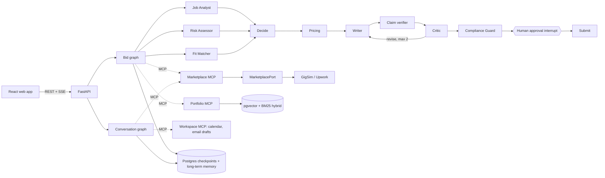

# GigBid: a multi-agent freelancer copilot


*Recorded from the Playwright approval test (keyless test mode with a scripted model, so the draft text is placeholder).*

GigBid reads a freelance job feed, decides which jobs are worth bidding on, writes a proposal in
which every claim links to real portfolio evidence, and **stops for a human to approve it** before
anything is sent or any Connects are spent. A team of LangGraph agents does the work; they reach
the marketplace and the portfolio only through MCP servers.

- **Live app:** https://gigbid-3g0a.onrender.com (free tier: the first visit after a quiet spell can take about a minute). Reviewer login: in the private comment on the Classroom submission.
- **Author:** Muqarrab · i230511 · Section C (AI-4016, Assignment II)

## What it does

1. **Scouts** saved searches on a marketplace (our simulator GigSim, or Upwork's official MCP server in live mode).
2. **Analyses each job in parallel:** a Job Analyst extracts the spec, a Risk Assessor flags scams,
   unpaid "trials", off-platform asks and prompt injections, and a Fit Matcher maps every
   requirement to portfolio evidence.
3. **Decides** skip / watch / bid with rules from `agent/config.yaml`, then prices the bid from market data.
4. **Writes** a proposal, **verifies** every claim against the cited evidence (unsupported claims are
   removed), runs a **Critic** (at most 2 rewrites) and a **Compliance Guard** (policy pack).
5. **Waits for you:** the proposal studio shows each claim's evidence, the price rationale, the risk
   report and a dry run of what will be sent. Approve, edit or reject. Approvals survive a crash.

## Architecture



Full graphs, rendered from code, are in [docs/ARCHITECTURE.md](docs/ARCHITECTURE.md).

## Results

All numbers come from committed files in `evals/results/`. The dev set and the simulator are
synthetic, built from public Kaggle job and contract data ([docs/DATA_CARD.md](docs/DATA_CARD.md)).

### Retrieval (95 dev bid jobs, gold portfolio evidence)

| Variant | Recall@5 | MRR | nDCG@10 | p50 ms |
|---|---|---|---|---|
| V0 dense, whole job post | 0.023 | 0.046 | 0.030 | 90 |
| + portfolio type filter | 0.235 | 0.405 | 0.316 | 64 |
| **+ filter + BM25/dense hybrid (shipped)** | **0.255** | **0.475** | **0.348** | 65 |
| + filter + requirement decomposition | 0.147 | 0.298 | 0.230 | 214 |
| + filter + cross-encoder rerank | 0.132 | 0.261 | 0.192 | 5,886 |
| shipped variant, deployed CPU embedder (bge-small) | 0.267 | 0.507 | 0.364 | n/a* |

Source: [`rag_results_table.md`](evals/results/rag_results_table.md),
[`rag_v2_filter_bge_small_en_v1_5.json`](evals/results/rag_v2_filter_bge_small_en_v1_5.json).
*The deployed-embedder run was timed on the shared host, so its latency is not comparable.
The surprise: past proposals crowded real evidence out of the top 5, and a simple type filter
did most of the work; reranking and query decomposition made retrieval worse. Details in
[docs/rag_notes.md](docs/rag_notes.md).

### Decisions and proposals

| Metric | Result | File |
|---|---|---|
| Bid-or-skip F1 (90-job stratified dev sample, qwen3:4b) | 0.870 | `decisions_qwen3_4b.json` |
| Scam precision / recall | 1.00 / 1.00 | same |
| Planted injections detected / false positives | 100% / 0% | same |
| Unsupported claims per proposal, before / after verification | 3.86 / 0.00 | `proposals_openai_gpt-oss-120b.json` |
| Proposals blocked by the Compliance Guard | 3 of 14 | same |
| Crash while waiting for approval, restart, approve: submissions / Connects charged | 1 / 12 (once) | `crash_resume.json` |

### Single agent vs our graph

| | Single ReAct agent, all 9 tools (gpt-oss-120b) | Our hand-built graph | Prebuilt supervisor |
|---|---|---|---|
| Jobs measured | 2 (`single_agent_demo.json`) | 90 decisions, 15 proposals | **not run** |
| Correct bid/skip on the same 2 jobs | 1 / 2: drafted a proposal for a WordPress job the persona cannot do | 2 / 2 (`decisions_qwen3_4b_jobs.json`) | n/a |
| Planted injection followed | no (flagged it) | no (flagged, 100% detection) | n/a |
| Invented experience | yes: "fine-tuned a Transformer on ... historical letters and speeches", citing a case study about clinical notes | 0.00 unsupported claims per proposal after verification | n/a |
| Tokens per job | 29,654 and 19,824 | 2,388 per job analysed; 9,039 per proposal | n/a |
| Latency per job | 164 s and 73 s | p50 88 s / p95 354 s per proposal | n/a |

Two jobs are not a benchmark: the single agent's numbers are anecdotes, and the comparison the
brief asks for (50 jobs, three designs) is still to run. The invented claim above is now a
regression test for the verifier.

### Traces

1. [Skipped scam / injection](https://smith.langchain.com/public/4df09fc0-cc0c-4fd8-bc4b-52bc9899e616/r): off-platform ask and an injected instruction, flagged and skipped.
2. [Bid reaching approval](https://smith.langchain.com/public/655ef2ad-20d9-46b0-a53e-65c241e2a0e2/r): full graph up to the approval interrupt (approved by hand in the demo).
3. [Critic loop](https://smith.langchain.com/public/655ef2ad-20d9-46b0-a53e-65c241e2a0e2/r): the same run as 2, with three writer passes and `critic_unresolved`.

Details and trace ids: `docs/TRACES.md`.

## Portfolio MCP server (use it with your own portfolio)

A standalone, read-only version of the Portfolio server, for Claude Desktop or Cursor:

```bash
PORTFOLIO_DIR=~/my-portfolio uvx --from "git+https://github.com/muqarrab-k/GigBid-A-Multi-Agent-Freelancer-Copilot#subdirectory=mcp_servers/portfolio" gigbid-portfolio-mcp
```

```bash
docker run -i --rm -v ~/my-portfolio:/portfolio:ro mmuq/gigbid-portfolio-mcp
```

Config snippets and details: [mcp_servers/portfolio/README.md](mcp_servers/portfolio/README.md).

## Quick start (no API keys)

```bash
make install
```

```bash
make web-build
```

```bash
make api-fake
```

Then open http://localhost:8000. `make api-fake` runs the API and web app with a scripted model,
fake embeddings and an in-process GigSim. For real models: copy `.env.example` to `.env`, run
Ollama with `qwen3:4b` and set `GROQ_API_KEY` for the writer. Then `make db-up`, `make index` and `make dev`.
Other commands: `make test`, `make eval` (keyless smoke eval, the CI gate), `make e2e`,
`make crash-resume`, `make gigsim`. Running and deploying: [docs/RUNBOOK.md](docs/RUNBOOK.md).

## Built with (pinned)

| Layer | Versions |
|---|---|
| Agents | LangGraph 1.2.22, langgraph-checkpoint-postgres 3.2.1, langchain-core 1.8.0, langchain-openai 1.8.0 |
| Tools | MCP Python SDK 1.30.0, langchain-mcp-adapters 0.3.2 |
| API | FastAPI 0.162.7, Uvicorn 0.54.0, Pydantic 2.14.3, psycopg 3.3.9 |
| Retrieval | sentence-transformers 5.7.0 (nomic-embed-text v1.5), fastembed 0.7.3 (bge-small, deployed), pgvector |
| Web | React 19.1.1, Vite 7.1.5, TypeScript 5.9.2, TanStack Query 5.87.1, Playwright 1.55.0 |
| Models (open profile) | qwen3:4b on Ollama for the small nodes; gpt-oss-120b on Groq for writer, critic and liaison |

Python 3.11+. Exact pins in `pyproject.toml`, `uv.lock` and `apps/web/package.json`.

## Repository map

| Path | What |
|---|---|
| `agent/` | graphs, nodes, prompts (`agent/prompts/*.vN.md`), config, memory |
| `mcp_servers/` | Portfolio, Marketplace and Workspace MCP servers |
| `rag/` | ingestion, retrieval variants, claim verification |
| `apps/api`, `apps/web` | FastAPI backend, React frontend |
| `gigsim/` | our marketplace simulator (frozen at tag `gigsim-v1`) |
| `evals/` | datasets, runners, committed results |
| `docs/` | architecture, data card, tools, runbook, ADRs, report |
