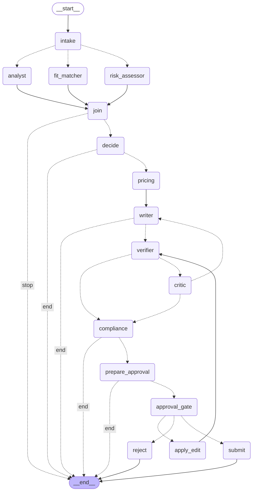

# Architecture

GigBid is a set of LangGraph agents that reach the outside world only through our MCP servers.
This page covers the marketplace and tool layer, retrieval, and the full bid graph: analysis,
writing, claim verification, Critic, Compliance, the human approval interrupt and submission,
with Postgres checkpoints.

```
agent node -> agent/mcp_client.py (allowlist, trace_id, retries) -> our MCP server
           -> MarketplacePort -> GigSim adapter (live Upwork later)
                              -> Portfolio retriever (RAG variant over pgvector)
```

## Bid graph (`agent/graphs/bid_graph.py`)

Rendered from code (`make graph-render` writes `docs/images/bid_graph.mmd`):



One thread per job. `intake` fans out with `Send` to three nodes that run in parallel, `join`
waits for all three and enforces the step and token budgets, `decide` applies the rules, and
only `bid` continues to `pricing` and then to the proposal half below.

| node | job | model | tools (allowlist) |
|---|---|---|---|
| analyst | JobSpec: deliverables, requirements, skills, budget, timeline, screening questions, hidden needs | cheap (qwen3) | none |
| risk_assessor | client quality from public history, scam / unpaid work / off-platform / injection flags; rules plus the model, every fired signal recorded | cheap (qwen3) | marketplace read |
| fit_matcher | its own requirement list, `search_evidence` per requirement, requirement-to-evidence matrix, fit score minus persona gaps | cheap (qwen3) + retriever | portfolio read |
| decide | skip / watch / bid from `decision` and `thresholds` in `agent/config.yaml`, with reasons | none (rules) | none |
| pricing | bid amount from market stats, client spend and the persona floor; whether the Connects cost is worth it | none (rules) | marketplace read incl. `get_market_stats` |
| scout (script) | saved searches, dedupe by job id and content hash; each new job starts its own thread | none | marketplace read |

**Decision rules** (first match wins, every fired rule is a reason): injected instructions are
flagged and never steer the decision (`injection_action: flag`); risk flags in `skip_flags`
(scam, unpaid work, off-platform) skip; risk above `maximum_risk_score` skips; a failed fit
analysis goes to watch for a human; a persona gap skips; a budget under the persona floor skips;
Connects above the per-job limit watches; then fit decides: `>= minimum_fit_score` bid,
`>= watch_fit_score` watch, else skip. A policy change is a config edit.

**Design trade-off: duplicated requirement extraction.** The analyst and the fit matcher both
pull requirements out of the job post. The fit matcher cannot wait for the analyst without
breaking the required parallelism, so it runs its own short extraction tuned for portfolio
search phrases. Cost: one extra small-model call per job (about 300 tokens) and two requirement
lists that can disagree. Benefit: the three branches stay independent and the slowest one sets
the latency. If they drift, the writer should use the analyst's list for the proposal and the
fit matrix only as evidence.

**Market stats.** GigSim is frozen and has no statistics endpoint, so `get_market_stats` on the
marketplace server serves `data/processed/pricing_stats.json` (made by `make data` from the
Kaggle jobs and contracts) and labels the source in every answer.

## Proposal half: writer to submit

| node | job | model | tools |
|---|---|---|---|
| writer | `ProposalDraft` in short paragraphs; every factual sentence ends with evidence ids; opens with the client's problem; screening answers; price from `PriceQuote`; on a revision it gets the Critic's reasons and the claims the verifier removed | strong (`writer` in config), local fallback | portfolio read incl. `get_evidence` |
| verifier | `rag/verify.py`: one claim per factual sentence; deterministic checks first (cited ids exist, every number and name appears in the cited evidence, key-word coverage), small-model judge only for the middle band; unsupported claims are removed before the Critic; before/after counts in `verification` | cheap | portfolio read |
| critic | rules: claims removed by the verifier, fewer than 2 grounded claims, generic opener, first paragraph not using the job's terms, length outside `writer.min_words..max_words`, missing screening answers. Pass or revise with reasons; at most `budgets.max_revisions` (2) rewrites, then the best draft goes on with a visible `critic_unresolved` note | none (rules) | none |
| compliance | `data/policy_pack/policy_rules.yaml` patterns and keywords for contact details, off-platform, guarantees, unpaid work, credentials; fabrication from the verifier's `unsupported_after`; the small model only for sentences with borderline words (`compliance.borderline_terms`). Any violation blocks (`compliance.clean_rules: []`); `cleaned_text` shows the draft without the flagged sentences | cheap, borderline only | none |
| prepare_approval | dry runs of `create_proposal_draft` and the Connects balance; payload: draft (with and without tags), claim table with evidence, risk report, price rationale, cost and balance after, verifier/critic/compliance notes | none | `approval` allowlist |
| approval_gate | `interrupt(payload)`; resume with `Command(resume={"action": "approve" \| "edit" \| "reject", ...})` | human | none |
| apply_edit | the human's text replaces the draft, a unified diff goes to `pending_edits` (style memory later); then verifier (report only, a human's words are never rewritten) and Compliance run again and the gate interrupts again | none | none |
| reject | records the reason in `submission` and ends with status `rejected` | none | none |
| submit | `create_proposal_draft` then `submit_proposal`, both through the marketplace MCP server, idempotency key `thread_id:sha256(draft, answers, price)`; marketplace down means status `queued`, never a crash | none | `approval` allowlist |

**Autonomy.** `autonomy.auto_skip_low_fit` lets the graph skip low-fit jobs on its own (off turns
those into `watch`). `autonomy.auto_send` is typed `Literal[False]`: a config that sets it to true
fails to load, and `submit` raises unless the stored approval says `approve`. The proposal eval
uses an auto-approver that lives only in `evals/runners/proposal_eval.py`.

**Durability.** Real runs use `AsyncPostgresSaver` in schema `langgraph`
(`agent/graphs/checkpoint.py`, `checkpointer` in config); tests use the in-memory saver. Only
our hand-off models may be deserialised from a checkpoint. `invoke` retries a failing thread
from its last checkpoint up to `nodes.max_attempts` (3) times, then marks it `dead_letter` with
every error. `make replay THREAD=<id> NODE=<name>` forks a thread from the checkpoint before a
node against a scratch GigSim. `make crash-resume` kills the process while it waits for approval
and again right after `submit_proposal` returns, then restarts; results in
`evals/results/crash_resume.json`.

## State, execution trace and long-term memory are separate

- **State** (`agent/state.py`, `BidState`): what this job needs right now: the raw job, the
  hand-offs (JobSpec, RiskReport, FitReport, BidDecision, PriceQuote), evidence, status, and
  the step and token counters. Fields that parallel branches write use reducers (evidence merges
  by id; counters, errors, failed hand-offs and trace events add up), so the three branches never
  clash. Checkpointed by `MemorySaver` for now, Postgres next.
- **Execution trace** (`state["trace"]` plus the MCP servers' audit logs): append-only events for
  every LLM call (model, attempt, tokens, latency, USD, cache hit) and tool call (name, args, ok,
  latency), all under one `trace_id` that also reaches the audit logs through MCP request meta.
  It is for audit and debugging; nodes never read it to decide anything.
- **Long-term memory** (next task, LangGraph store): only promoted knowledge (style and outcome
  memory) written by an explicit rule in `agent/memory/promotion_rules.py`. Raw tool output and
  trace events never go there.

## Node plumbing (`agent/nodes/common.py`)

- Every prompt is a versioned file in `agent/prompts/` (`analyst.v1.md`, `risk_assessor.v1.md`,
  `fit_matcher.v1.md`, plus `untrusted_rule`, `json_output`, `json_retry` fragments).
- `untrusted()` wraps job and client text in `<untrusted>` tags with the standard data-only rule;
  the text cannot close the block itself.
- `structured()` asks for JSON (JSON mode, qwen3 thinking off), validates against the node's
  Pydantic model, retries once with the validation error, then tries the fallback model; if all
  fail, the hand-off is listed in `failed` and the graph continues.
- An LLM cache keyed by model and full prompt makes eval reruns free and reproducible.
- `ToolBox` gives a node only its allowlisted tools and logs each call to the trace.

## Measured so far (decision eval, 90-job stratified dev sample)

`make decision-eval` and `make decision-eval MODEL=qwen3:8b`. Fallback model: Groq
`openai/gpt-oss-20b`. Latency and tokens are from the live runs (commit `0442e4d`); the second
pair of runs replays the cached model replies under the new rule, so only `decide` changed.

| cheap nodes | rule set | bid F1 | scam P / R | injection detected / false pos. | price in band | latency p50 / p95 | tokens / job | file |
|---|---|---|---|---|---|---|---|---|
| qwen3:4b | model flags skip | 0.692 | 0.69 / 1.00 | 100% / 0% | 18 / 18 | 25.9 s / 54.5 s | 2,388 | `decisions_qwen3_4b_model_flags_skip.json` |
| qwen3:8b | model flags skip | 0.278 | 0.28 / 1.00 | 100% / 0% | 5 / 5 | 44.4 s / 73.2 s | 2,394 | `decisions_qwen3_8b_model_flags_skip.json` |
| **qwen3:4b** | **flags need a rule** | **0.750** | **1.00 / 1.00** | 100% / 0% | 21 / 21 | same as above | same | `decisions_qwen3_4b.json` |
| qwen3:8b | flags need a rule | 0.571 | 0.90 / 1.00 | 100% / 0% | 14 / 14 | same as above | same | `decisions_qwen3_8b.json` |

Cost per job is effectively zero (local models; the paid fallback ran a handful of times).

**What changed.** The small models over-flag: on the 72 non-scam jobs the 8B model added
`vague_scope` 71 times, `low_budget` 70 times and `off_platform` 42 times (4B: 28, 15 and 3).
With `decision.model_flags_need_rule: true`, a skip flag that only the model raised counts only
when a rule signal backs it (a scam, unpaid-work or off-platform pattern, or a client red flag
from `decision.corroborating_signals`). Injection detection is deliberately not a corroborating
signal, so injected text cannot push a job to skip by itself.

**Caveats.** The rule was designed after looking at these errors on this same sample, so the
gain needs confirming on the full dev set (`FULL=1`) before it counts. Scam recall of 1.0 is
partly circular: the rule patterns were written with our scam templates in view. The remaining
4B errors are mostly real bids with fit 0.50 to 0.58 in the watch band; fullstack is the weakest
persona (F1 0.57 vs ai_ml 0.88). qwen3:4b stays the cheap-node model: better on every metric
and about 40% faster than 8B.

**Check on a fresh sample.** `make decision-eval` with `--fresh` draws a second stratified 90-job
sample with seed 43, disjoint from the first; `--corroboration off|on` overrides the rule. The
`on` run replays the `off` run's cached model replies (analysis inputs identical on 90/90 jobs),
so only `decide` differs.

| qwen3:4b, fresh sample | bid F1 | scam P / R | injection detected / false pos. | price in band | latency p50 / p95 | tokens / job | file |
|---|---|---|---|---|---|---|---|
| model flags skip | 0.667 | 0.67 / 1.00 | 100% / 0% | 15 / 18 | 25.5 s / 63.8 s | 2,520 | `decisions_qwen3_4b_fresh_corroboration_off.json` |
| flags need a rule | 0.643 | 0.86 / 1.00 | 100% / 0% | 15 / 18 | replay | replay | `decisions_qwen3_4b_fresh_corroboration_on.json` |

Only 4 decisions changed, all on gold-skip jobs: two moved to watch and two to bid. So on unseen
jobs the rule still removes false scam calls (precision 0.67 to 0.86, recall unchanged) but it does
not improve bid F1; the +0.06 on the first sample was partly tuning to that sample. We keep the
rule because a wrong scam skip hides a real job from the user, and a wrong bid still stops at the
human approval gate.
