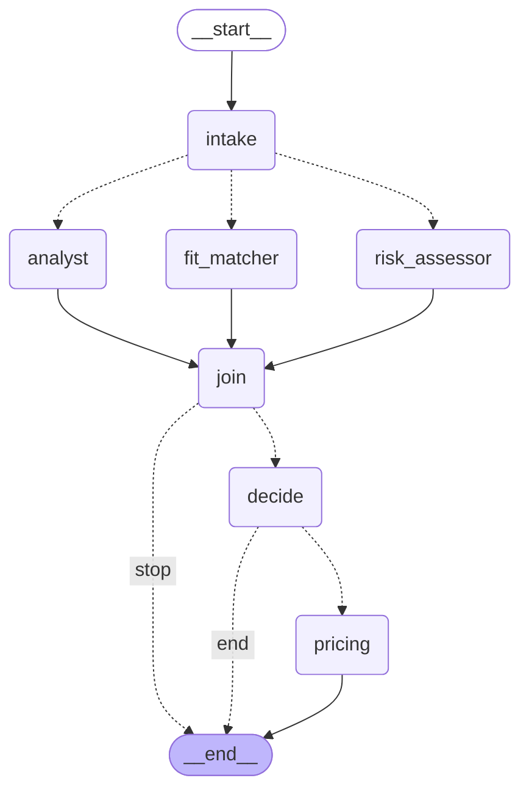

# Architecture

GigBid is a set of LangGraph agents that reach the outside world only through our MCP servers.
This page covers what exists so far: the marketplace and tool layer, retrieval, and the
analysis half of the bid graph. The writer, claim verification, Critic, Compliance, approval
interrupts and Postgres persistence come next.

```
agent node -> agent/mcp_client.py (allowlist, trace_id, retries) -> our MCP server
           -> MarketplacePort -> GigSim adapter (live Upwork later)
                              -> Portfolio retriever (RAG variant over pgvector)
```

## Bid graph, analysis half (`agent/graphs/bid_graph.py`)

Rendered from code (`make graph-render` writes `docs/images/bid_graph_analysis.mmd`):



One thread per job. `intake` fans out with `Send` to three nodes that run in parallel, `join`
waits for all three and enforces the step and token budgets, `decide` applies the rules, and
only `bid` continues to `pricing`, which ends with status `ready_for_writer`.

| node | job | model | tools (allowlist) |
|---|---|---|---|
| analyst | JobSpec: deliverables, requirements, skills, budget, timeline, screening questions, hidden needs | cheap (qwen3) | none |
| risk_assessor | client quality from public history, scam / unpaid work / off-platform / injection flags; rules plus the model, every fired signal recorded | cheap (qwen3) | marketplace read |
| fit_matcher | its own requirement list, `search_evidence` per requirement, requirement-to-evidence matrix, fit score minus persona gaps | cheap (qwen3) + retriever | portfolio read |
| decide | skip / watch / bid from `decision` and `thresholds` in `agent/config.yaml`, with reasons | none (rules) | none |
| pricing | bid amount from market stats, client spend and the persona floor; whether the Connects cost is worth it | none (rules) | marketplace read incl. `get_market_stats` |
| scout (script) | saved searches, dedupe by job id and content hash; each new job starts its own thread | none | marketplace read |

**Decision rules** (first match wins, every fired rule is a reason): injected instructions are
flagged and never steer the decision (`injection_action: flag`); risk flags in `skip_flags`
(scam, unpaid work, off-platform) skip; risk above `maximum_risk_score` skips; a failed fit
analysis goes to watch for a human; a persona gap skips; a budget under the persona floor skips;
Connects above the per-job limit watches; then fit decides: `>= minimum_fit_score` bid,
`>= watch_fit_score` watch, else skip. A policy change is a config edit.

**Design trade-off: duplicated requirement extraction.** The analyst and the fit matcher both
pull requirements out of the job post. The fit matcher cannot wait for the analyst without
breaking the required parallelism, so it runs its own short extraction tuned for portfolio
search phrases. Cost: one extra small-model call per job (about 300 tokens) and two requirement
lists that can disagree. Benefit: the three branches stay independent and the slowest one sets
the latency. If they drift, the writer should use the analyst's list for the proposal and the
fit matrix only as evidence.

**Market stats.** GigSim is frozen and has no statistics endpoint, so `get_market_stats` on the
marketplace server serves `data/processed/pricing_stats.json` (made by `make data` from the
Kaggle jobs and contracts) and labels the source in every answer.

## State, execution trace and long-term memory are separate

- **State** (`agent/state.py`, `BidState`): what this job needs right now: the raw job, the
  hand-offs (JobSpec, RiskReport, FitReport, BidDecision, PriceQuote), evidence, status, and
  the step and token counters. Fields that parallel branches write use reducers (evidence merges
  by id; counters, errors, failed hand-offs and trace events add up), so the three branches never
  clash. Checkpointed by `MemorySaver` for now, Postgres next.
- **Execution trace** (`state["trace"]` plus the MCP servers' audit logs): append-only events for
  every LLM call (model, attempt, tokens, latency, USD, cache hit) and tool call (name, args, ok,
  latency), all under one `trace_id` that also reaches the audit logs through MCP request meta.
  It is for audit and debugging; nodes never read it to decide anything.
- **Long-term memory** (next task, LangGraph store): only promoted knowledge (style and outcome
  memory) written by an explicit rule in `agent/memory/promotion_rules.py`. Raw tool output and
  trace events never go there.

## Node plumbing (`agent/nodes/common.py`)

- Every prompt is a versioned file in `agent/prompts/` (`analyst.v1.md`, `risk_assessor.v1.md`,
  `fit_matcher.v1.md`, plus `untrusted_rule`, `json_output`, `json_retry` fragments).
- `untrusted()` wraps job and client text in `<untrusted>` tags with the standard data-only rule;
  the text cannot close the block itself.
- `structured()` asks for JSON (JSON mode, qwen3 thinking off), validates against the node's
  Pydantic model, retries once with the validation error, then tries the fallback model; if all
  fail, the hand-off is listed in `failed` and the graph continues.
- An LLM cache keyed by model and full prompt makes eval reruns free and reproducible.
- `ToolBox` gives a node only its allowlisted tools and logs each call to the trace.

## Measured so far (decision eval, 90-job stratified dev sample)

`make decision-eval` and `make decision-eval MODEL=qwen3:8b`, commit `0442e4d`; files
`evals/results/decisions_qwen3_4b.json` and `evals/results/decisions_qwen3_8b.json`. Fallback
model: Groq `openai/gpt-oss-20b`.

| cheap nodes | bid F1 | scam P / R | injection detected / false pos. | price in band | latency p50 / p95 | tokens / job | USD / job |
|---|---|---|---|---|---|---|---|
| qwen3:4b | 0.692 | 0.69 / 1.00 | 100% / 0% | 18 / 18 | 25.9 s / 54.5 s | 2,388 | ~0.00001 |
| qwen3:8b | 0.278 | 0.28 / 1.00 | 100% / 0% | 5 / 5 | 44.4 s / 73.2 s | 2,394 | ~0.000002 |

The 8B model over-flags: on the 72 non-scam jobs it added `vague_scope` 71 times,
`low_budget` 70 times and `off_platform` 42 times (4B: 28, 15 and 3), so 47 clean jobs were
skipped as scams. Model-only flags are the weak point in both configs; the rule patterns found
every planted scam, but they were written with our scam templates in view, so that recall is
partly circular. Next step to test: model flags should only skip a job when a rule corroborates
them. Latency is local Ollama on a laptop, with the three parallel branches sharing one model.
